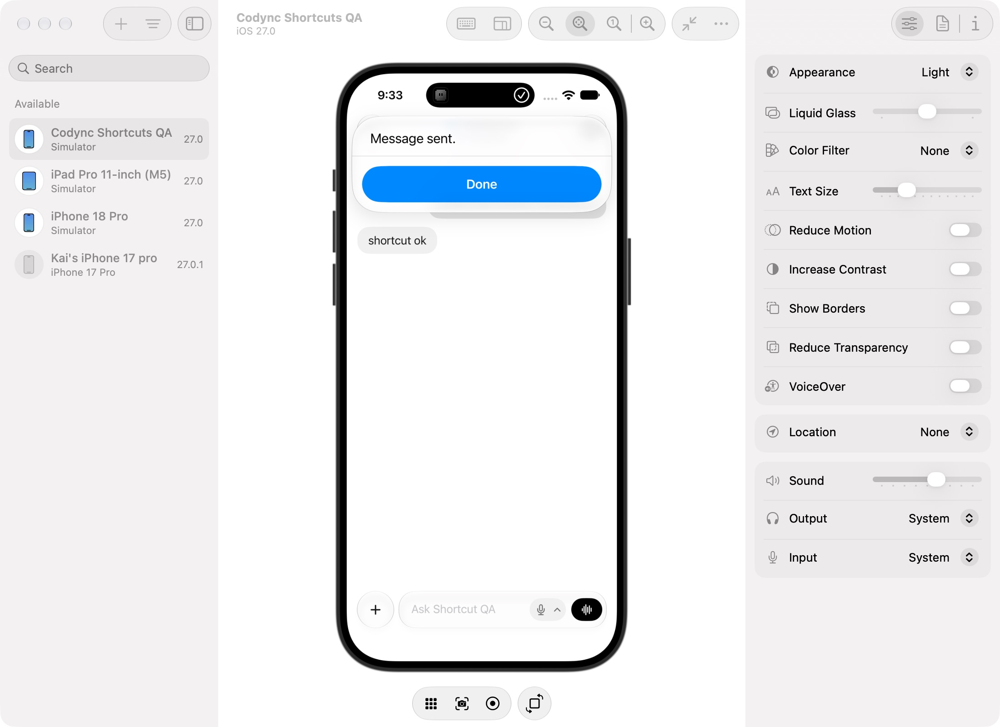
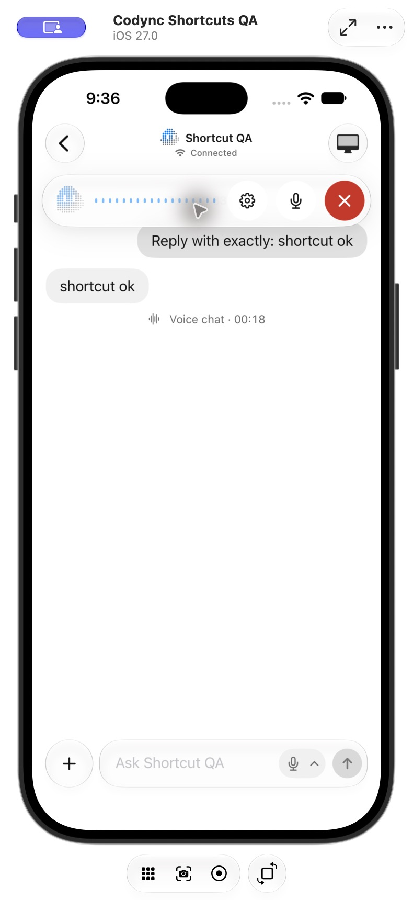

# iOS BOT 快捷指令交付与验证

时间：2026-10-23 21:36 America/Los_Angeles。版本：2.25.0。

## 结果

- **Open Live Mode**：BOT 是可选择的输入。支持固定 BOT、快捷指令变量或每次询问；打开目标聊天并启动现有语音通话。
- **Send Text to Bot**：BOT 与 Text 都是输入。复用现有发送、nonce 去重及离线邮箱，等待接收确认后才返回成功；保留原聊天草稿。
- 两个动作都在 iOS 系统 Shortcuts 中可发现，并将 Codync 带到前台。无需输入 BOT ID 或拼接 URL。
- 实体 ID 包含账号及电脑作用域。隐藏/删除 BOT、移除电脑、切换账号后的旧选择会被拒绝。

使用说明：[iOS Shortcuts](../features/ios-shortcuts.md)。

## 自动验证

- iOS Dev / DevDebug，iOS 27.0 Simulator：构建成功，正常模拟器签名。
- CodyncKit-Package：227 项 Swift Testing 测试通过（CodyncUI 106、CodyncKit 121）。
- 新增测试覆盖：账号隔离、隐藏 BOT、移除电脑、目标 BOT 延迟同步、全局 revision 高于 BOT revision、空输入、无效 BOT、电脑拒绝发送、取消重试、送达确认、离线邮箱接收、草稿保留、Live 请求一次消费及 store 退出。
- App Intents 元数据包含两个动作；iOS、host、desktop 与 lockfile 的发布版本一致。
- `git diff --check` 通过。

## 实际应用验证

通过 Xcode Device Hub 控制独立的 **Codync Shortcuts QA** 模拟器，连接本任务隔离的真实 Rust Host（19387 端口），未使用生产账号或复制生产设备凭据。Host 代码无行为修改，使用已有兼容的 2.24.0 开发二进制。

| 平台/流程 | 结果 | 观察 |
| --- | --- | --- |
| iOS / Shortcuts 发现动作 | pass | 搜索 Codync 可见 Open Live Mode 与 Send Text to Bot。 |
| iOS / BOT 参数选择 | pass | 列出测试 BOT 和电脑名称；可进入 Variables → Ask Each Time。 |
| iOS / 冷启动发送文字 | pass | 先终止 Codync Dev，再从系统 Shortcuts 发送；出现 Message sent，Host 保存用户消息，真实 Codex BOT 回复 `shortcut ok`。 |
| iOS / Live 每次询问 BOT | pass | 运行时显示 BOT 选择，选中后直接打开正确聊天；首次走正常麦克风和语音识别权限，进入 Listening。 |
| iOS / 已有聊天弹层 | pass | 先打开 Full conversation，再运行 Live；弹层关闭，显示 Listening 与通话控件。 |
| iOS / 结束通话 | pass | 两次测试均通过 End call 结束，聊天出现 Voice chat 时长。 |
| iOS / 离线邮箱 | unit-tested | 隔离 Host 关闭云连接，未进行真实 relay 邮箱 E2E；FakeRemote 回归验证接收后才返回 queued。 |
| iOS / 远程屏幕覆盖层清理 | static-reviewed | 已清除所有 store 的 screenRequest；本轮未启动远程屏幕辅助进程进行该分支 E2E。 |
| 实体 iPhone / Siri、锁屏、语音往返 | not_run | 本轮在模拟器验证系统 Shortcuts 和 Listening；未验证实体设备的 Siri、锁屏或实际语音识别往返。 |
| macOS/Linux/Windows/Android/TUI | not_applicable | 本次新增 iOS App Intents 入口；检查了其他客户端的对应聊天/通话实现，功能逻辑和界面无需变化，仅统一发布版本。 |

首次文字试运行因测试 Host 仅绑定 loopback、而公布了 LAN/Tailscale 地址而失败；修正隔离 Host 的监听配置后，最终构建的冷启动发送及 Live 流程均通过。此问题未要求产品代码修改。

## 审查与修正

按 after-change 执行 correctness、completeness、refactor 三项并行只读审查，随后由独立 verifier 核对发现。修复了三个确认的问题：冷启动过早判断 BOT 不存在；已有远程屏幕/聊天弹层遮住 Live；取消快捷指令未传播至发送重试。

复核还发现 Host 的全局 revision 可能包含不出现在 BOT/entry 流中的记忆更新；最终只在目标 BOT 尚未到达时等待，避免合法 BOT 因全局 revision 无法追平而超时。对应回归测试通过。最终只读复核无新增实质问题。

未做无关重构。保持现有 Host API 与兼容性下限，发布版本从 v2.24.0 升为 2.25.0，并补齐繁中及英文 What's New。

## 界面证据

## 交付限制

`git pull --rebase --autostash origin dev` 已完成；原分支已有提交没有混入本功能工作区。`git push origin dev` 返回 403（当前 GitHub 账号 icework 对 leepokai/Codync 无推送权限），因此无法直接完成上游 dev 的合并发布。本功能保留独立分支，供上游 PR 审阅。
